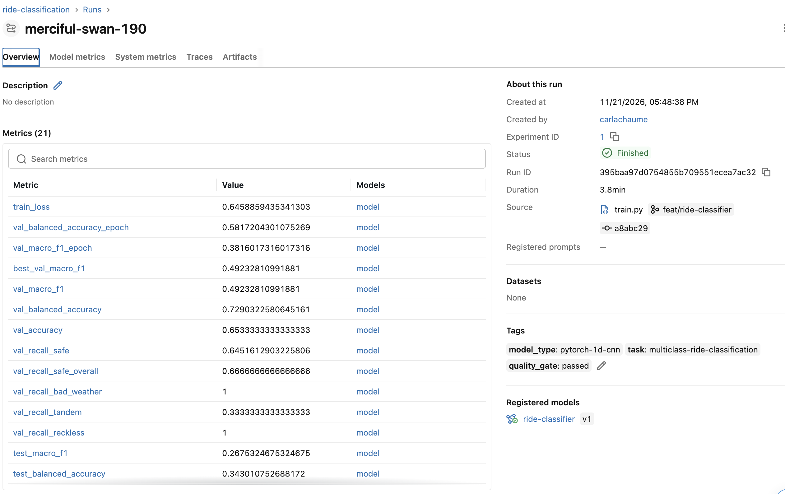
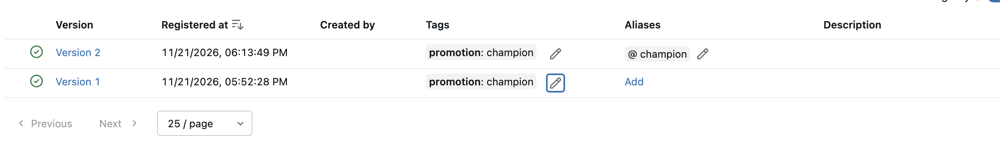
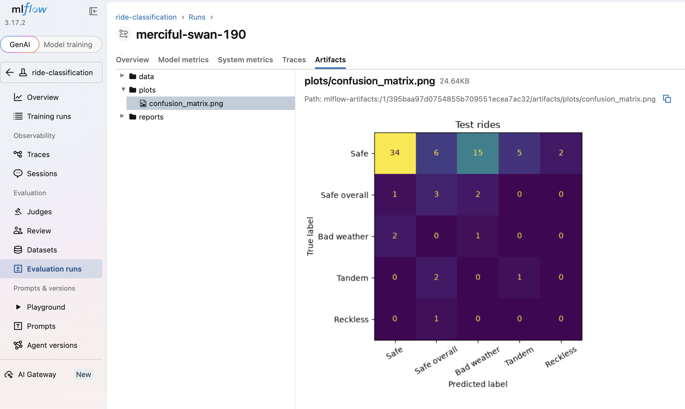
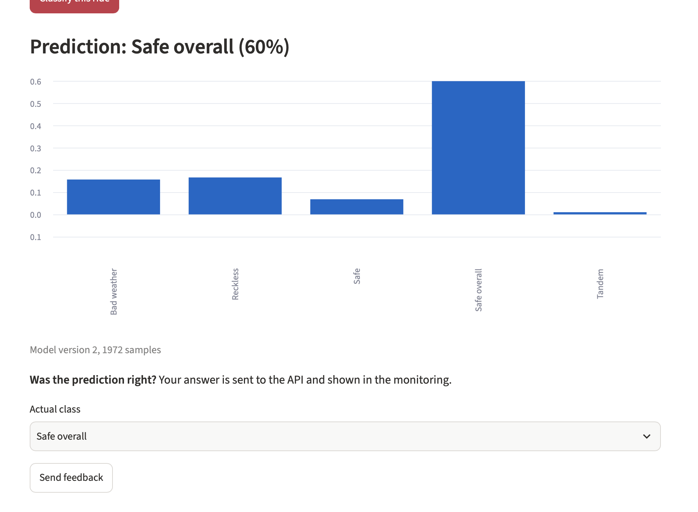

# Scooter ride classification — MLOps project

[](https://github.com/carlachm/ride-classification-mlops/actions/workflows/ci.yml)

End-to-end MLOps pipeline that classifies e-scooter rides into **5 categories** — *Safe*, *Safe overall*,
*Bad weather*, *Tandem*, *Reckless* — from the IMU signals of the vehicle (accelerometer `ax, ay, az`,
gyroscope `rx, ry, rz`, 10 Hz), using the **GBG500** dataset (500 rides in Gothenburg).

The goal of the project is not the best possible accuracy but a **reproducible, tracked, tested and
automatically deployed** model: data versioning (DVC), experiment tracking and model registry (MLflow + MinIO),
CI/CD (GitHub Actions), serving (FastAPI + Streamlit) and deployment on Kubernetes.

**Docker images (Docker Hub)** — tagged with the 7-character commit SHA, never `latest`:

| Image | Content |
|---|---|
| [`carlachm/ride-train`](https://hub.docker.com/r/carlachm/ride-train/tags) | training pipeline (prepare → train → MLflow registry) |
| [`carlachm/ride-api`](https://hub.docker.com/r/carlachm/ride-api/tags) | FastAPI scoring API |
| [`carlachm/ride-webapp`](https://hub.docker.com/r/carlachm/ride-webapp/tags) | Streamlit web app |

---

## Table of contents

1. [Architecture](#architecture)
2. [Repository structure](#repository-structure)
3. [Quick start](#quick-start)
4. [Data](#data)
5. [Model](#model)
6. [Experiment tracking and model registry (MLflow)](#experiment-tracking-and-model-registry-mlflow)
7. [Results](#results)
8. [Serving: API and web app](#serving-api-and-web-app)
9. [Production: Kubernetes](#production-kubernetes)
10. [Monitoring and retraining](#monitoring-and-retraining)
11. [CI/CD (GitHub Actions)](#cicd-github-actions)
12. [Tests](#tests)
13. [Reproducibility](#reproducibility)
14. [Team and workflow](#team-and-workflow)

---

## Architecture

```
                ┌──────────────────────────── dev: docker compose ─────────────────────────────┐
                │                                                                               │
 make repro ───▶│  MLflow server :5050 ──metadata──▶ PostgreSQL                                 │
 (DVC pipeline) │  (tracking + registry) ─artifacts─▶ MinIO (S3) :9000/:9001                   │
                │                                     ├─ bucket mlflow/  (models, plots)        │
 dvc push/pull ─┼────────────────────────────────────▶└─ bucket dvc/     (versioned GBG500)     │
                └───────────────────────────────────────────────────────────────────────────────┘
                                   ▲  models:/ride-classifier@champion
                                   │
 browser ──▶ ride-webapp (Streamlit :8501) ──▶ ride-api (FastAPI :8000) ──┬─▶ /metrics (Prometheus)
                                                                           └─▶ logs/predictions.jsonl
                ── prod: the same API + web app on Kubernetes (Docker Desktop / kind) ──
```

- **PostgreSQL** stores MLflow runs, parameters, metrics and the model registry.
- **MinIO** (S3-compatible) stores the models and plots (`mlflow` bucket) and the DVC-versioned data (`dvc` bucket).
- MLflow runs with `--serve-artifacts`: training and the API read/write artifacts **through** the MLflow server,
  so they never need the S3 credentials.
- The API always loads **`models:/ride-classifier@champion`**: promoting or rolling back a model is just moving
  the alias, without redeploying the API.

## Repository structure

```
├── src/fraud_detection/      # Python package (historical name, see note below)
│   ├── config.py             #   params.yaml loading, seeds, shared column/class names
│   ├── data.py               #   GBG500 loading, validation, cleaning, split by ride, synthetic rides
│   ├── model.py              #   pre-processing, 1D-CNN, MLflow pyfunc wrapper (API contract)
│   ├── evaluate.py           #   macro-F1, per-class recall, baseline, confusion matrix
│   ├── registry.py           #   champion promotion (alias @champion)
│   ├── train.py              #   training + MLflow logging + registration + quality gate
│   ├── api/                  #   FastAPI app (schemas, model loading, metrics, placeholder model)
│   ├── monitoring/           #   drift detection, prediction log, traffic simulator
│   └── retraining/           #   labelled production rides, retraining trigger
├── webapp/                   # Streamlit app
├── tests/                    # unit + integration tests (86)
├── k8s/                      # Kubernetes manifests (namespace, configmap, api, webapp)
├── loadtest/                 # Locust load test
├── docker/                   # Dockerfiles: mlflow server, api, webapp
├── Dockerfile                # training image (ride-train)
├── docker-compose.yml        # dev stack: MinIO + PostgreSQL + MLflow + Prometheus + Grafana
├── infra/                    # Prometheus (scrape, alert rules + tests), Grafana (provisioned dashboard)
├── .github/workflows/        # ci.yml (lint, test, images), train.yml, deploy.yml
├── dvc.yaml / dvc.lock       # DVC pipeline: prepare -> train
├── params.yaml               # ALL hyper-parameters (single source of truth)
├── pyproject.toml / uv.lock  # dependencies (uv)
├── docs/                     # interface contract, monitoring, runbooks, retraining
└── Makefile                  # shortcuts (`make help`)
```

> The package keeps its historical name `fraud_detection` (the first subject of the course was fraud detection).
> Renaming it would touch every import, Dockerfile and open branch, so we kept it to avoid breaking changes.

## Quick start

Prerequisites: Docker Desktop, Git, [uv](https://docs.astral.sh/uv/) (`curl -LsSf https://astral.sh/uv/install.sh | sh`).

```bash
make install               # uv sync --locked: Python 3.12 + exact versions from uv.lock
cp .env.example .env       # local settings (MLflow on port 5050, MinIO credentials)

make up                    # MinIO + PostgreSQL + MLflow
#   MLflow UI     -> http://localhost:5050
#   MinIO console -> http://localhost:9001  (minioadmin / minioadmin123)

make dvc-setup             # DVC remote = MinIO bucket
make data                  # dvc pull: get GBG500 (or put the files from Inside in data/raw/ and `dvc add` them)
make repro                 # DVC pipeline: prepare -> train (only re-runs what changed)
uv run dvc metrics show

make api                   # http://localhost:8000/docs (Swagger)
make webapp                # http://localhost:8501
```

No data at hand? `make sample` generates synthetic rides with the exact GBG500 schema
(used by the tests and the CI smoke test).

> **macOS notes** — Port 5000 is taken by AirPlay Receiver, hence MLflow on **5050** (`MLFLOW_PORT` in `.env`).
> `MLFLOW_ENABLE_PROXY_MULTIPART_DOWNLOAD=false` makes model downloads go through the MLflow server
> (MinIO's address `minio:9000` only exists inside Docker). Both are already set in `.env.example`.

## Data

| File | Content |
|---|---|
| `data/raw/GBG500.parquet` | 1 529 547 IMU samples: `ride_id`, `time_index` (ms), `ax, ay, az, rx, ry, rz` |
| `data/raw/GBG500_labels.csv` | one label per ride (`RIDE_ID`, `LABEL`) |

Both files come from Inside and are **versioned with DVC** (`*.dvc` pointers in Git, bytes in MinIO).

| Class | Rides | Share |
|---|---|---|
| Safe | 416 | 83.2 % |
| Safe overall | 38 | 7.6 % |
| Bad weather | 22 | 4.4 % |
| Tandem | 18 | 3.6 % |
| Reckless | 6 | 1.2 % |

Preparation (`python -m fraud_detection.data prepare`, `src/fraud_detection/data.py`):

- **Validation**: expected columns, known labels, one label per ride, no ride with a fully empty sensor channel,
  no infinite values (a failing check stops the pipeline).
- **Cleaning**: samples sorted by time inside each ride, duplicated timestamps removed (1 in GBG500).
  Missing values (0.67 % of samples, sensor dropouts) are kept and handled **inside the model**, exactly as at
  serving time.
- **Split by ride, stratified on the class**: 70 / 15 / 15 % → 350 / 75 / 75 rides. Windows of the same ride
  never end up in both training and test (no leakage).

> The original dataset description frames GBG500 as an *anomaly detection* problem (Reckless as the positive class,
> the other categories as counterfactuals near the decision boundary). The project subject asks for a
> **5-class classification**, so we train a supervised classifier on the labels and pay special attention to
> Reckless and to the confusions between the "counterfactual" classes in the evaluation.

## Model

A **1D convolutional neural network** (PyTorch) over time, with the same pipeline at training and serving time:

```
ride (n × 6, NaN allowed) → fill NaN (forward/backward fill) → standardise (train statistics)
  → windows of 30 s (300 samples, 50 % overlap) → 1D-CNN → softmax per window → mean over windows → 5 probabilities
```

| Choice | Why |
|---|---|
| 1D-CNN (3 conv blocks 32→64→128, global average pooling) | learns local motion patterns (bumps, swerves, oscillations) directly from the raw signals |
| Windows + averaging | rides last 3 to 8 minutes: windows give more training examples and work for any ride length (100 to 20 000 samples at serving time) |
| Class-weighted cross-entropy (`balanced`) | without weights the model only predicts "Safe" (83 % of rides) |
| Early stopping on the **ride-level validation macro-F1** | selects the model on the metric we care about |
| Pre-processing inside the MLflow pyfunc | the API stays model-agnostic and sends raw samples (see `docs/api-contract.md`) |

**Metrics.** Accuracy is misleading here: always answering "Safe" gives 83 % accuracy and detects nothing.
The headline metric is the **macro-F1** (every class weighs the same), with the balanced accuracy, the per-class
recall (Reckless in particular) and the confusion matrix.

**Quality gate.** A new model is promoted to `@champion` only if its test macro-F1 is ≥
`quality_gate.min_test_macro_f1` (0.20 in `params.yaml`) **and** better than the "always Safe" baseline **and**
better than the current champion. Otherwise the version is tagged `gate_failed` / `rejected` and
`python -m fraud_detection.train` exits with code 1 (red CI job / failed DVC stage).

## Experiment tracking and model registry (MLflow)

Every training run logs to the `ride-classification` experiment:

- **Parameters**: all of `params.yaml` (data split, windows, model, training), class weights, number of windows.
- **Metrics**: per epoch (`train_loss`, `val_macro_f1_epoch`, `val_balanced_accuracy_epoch`), then final
  `val_*` / `test_*` (macro-F1, balanced accuracy, accuracy, recall per class) and `baseline_majority_macro_f1`.
- **Artifacts**: confusion matrix, classification report, per-ride test predictions, data statistics, the model.
- **Tags**: model type, quality gate result, and automatically the **Git commit and branch** that produced the run.



The model is registered as **`ride-classifier`**; each training creates a new version and the best one carries
the alias **`@champion`** (aliases replace the deprecated Staging/Production stages). Rolling back = moving the
alias to a previous version in the MLflow UI; the API picks it up at its next start / rollout.



## Results

Evaluation on the **75 test rides** never seen during training or model selection
(62 Safe, 6 Safe overall, 3 Bad weather, 3 Tandem, 1 Reckless):

| Model | Test macro-F1 | Balanced accuracy | Accuracy |
|---|---|---|---|
| Always "Safe" (baseline) | 0.18 | 0.20 | 0.83 |
| **1D-CNN (`ride-classifier@champion`)** | **0.27** | **0.34** | 0.52 |

| Class | Precision | Recall | Test rides |
|---|---|---|---|
| Safe | 0.92 | 0.55 | 62 |
| Safe overall | 0.25 | 0.50 | 6 |
| Bad weather | 0.06 | 0.33 | 3 |
| Tandem | 0.17 | 0.33 | 3 |
| Reckless | 0.00 | 0.00 | 1 |



**Reading the results**

- The model **beats the baseline** (macro-F1 0.27 vs 0.18) and passes the quality gate: it detects part of every
  minority class except Reckless, which the baseline never does.
- Its main error is over-predicting *Bad weather* (15 Safe rides), which costs Safe recall.
- The only Reckless test ride is predicted *Safe overall* — exactly the "counterfactual near the decision boundary"
  difficulty described with the dataset. In the web app, Reckless comes second (17 %) for this ride.
- With 1 to 6 test rides per minority class, one ride more or less changes the scores a lot: the numbers are
  indicative. Validation macro-F1 (0.49) is higher because the best epoch is selected on it.
- Re-running the pipeline with the same data, code and parameters gives exactly the same test macro-F1 (0.2675):
  the training is reproducible.

**Hyper-parameter search.** Six configurations were compared, the choice being made on the **validation** set:

| Run | Learning rate | Window | Class weights | Val macro-F1 | Test macro-F1 |
|---|---|---|---|---|---|
| **A (selected)** | **3e-4** | **30 s** | **balanced** | **0.49** | **0.27** |
| B | 3e-4 | 30 s | sqrt | 0.47 | 0.19 |
| C | 3e-4 | 60 s | balanced | 0.41 | 0.22 |
| D | 3e-4 | 60 s | sqrt | 0.47 | 0.23 |
| E | 1e-3 | 30 s | sqrt | 0.47 | 0.23 |
| F | 3e-4 | 15 s | balanced | 0.40 | 0.28 |

The first configuration (learning rate 1e-3) was unstable (validation macro-F1 jumping between 0.05 and 0.48 from
one epoch to the next), hence the lower learning rate and the longer early-stopping patience.

**Next steps**: stratified k-fold cross-validation (more reliable scores with so few minority rides),
data augmentation of the minority classes, per-window features (variance, jerk, spectral energy) as an
interpretable baseline, and pre-training on the unlabelled SRV3490 rides.

## Serving: API and web app

| Method | Path | Purpose |
|---|---|---|
| GET | `/health` | liveness (`ok` / `degraded` when no model is loaded) |
| GET | `/ready` | readiness: 200 only once a model is loaded |
| POST | `/v1/predict` | classify one ride (100 to 20 000 samples, `null` allowed) |
| POST | `/v1/feedback` | send the true class of a past prediction |
| GET | `/metrics/` | Prometheus metrics (requests, latency, input drift, predictions, feedback) |

Interactive documentation (Swagger): `http://localhost:8000/docs`. Invalid input gives a clear **422**, no model
gives **503**. Every prediction is appended as a JSON line to `logs/predictions.jsonl` (per-ride channel
mean/std for drift detection). The full contract is in [docs/api-contract.md](docs/api-contract.md).

The web app sends a demo ride or an uploaded CSV/Parquet ride to the API, shows the 5 probabilities and lets the
user send feedback (the true class), which feeds the monitoring:



Load test: `make load` (Locust, 20 users for 1 min, report in `reports/`).

## Production: Kubernetes

The "production" environment runs the API and the web app on the local Kubernetes cluster of Docker Desktop
(or kind), the model being loaded from the MLflow registry.

| Element | Details |
|---|---|
| API | 2 replicas, RollingUpdate with `maxUnavailable: 0`, startup / readiness (`/ready`) / liveness (`/health`) probes, resource requests and limits, non-root |
| Web app | 1 replica, NodePort 30501 → `localhost:8501` |
| Config | `ride-api-config` ConfigMap: MLflow URI, model name and alias (no secret needed) |
| Deployment | `scripts/deploy_k8s.sh`: applies the manifests with the image tag, waits for the rollout, checks a real prediction through the Service, **rolls back automatically** if the rollout fails |

```bash
make serving-build
MLFLOW_URI_FOR_PODS=http://host.docker.internal:5050 bash scripts/deploy_k8s.sh ride-api:dev ride-webapp:dev
make k8s-forward          # API on :8080, web app on :8501
kubectl -n ride get pods
```

## Monitoring and retraining

| Layer | Watched | Alerts |
|---|---|---|
| Infrastructure | API up, model loaded, latency, 5xx | `ApiDown`, `ModelNotLoaded`, `LatencyP95High`, `ErrorRateHigh` |
| Inputs | signal variability vs training, missing values, rejected rides | `InputShift`, `InputUnitSuspected`, `MissingValuesHigh`, `RejectedRidesHigh` |
| Predictions | share of each class, confidence | `SafeShareShift` |
| Outcome | accuracy on the feedback, missed Reckless rides | `FeedbackAccuracyDrop`, `RecklessRideMissed` |

- **Prometheus** (:9090) + **Grafana** (:3000) start with `make up`; rules have unit tests (`make alerts-test`).
- **Drift check** (`make drift`): PSI + Kolmogorov-Smirnov per ride feature, calibrated on GBG500 (the usual
  "10 bins, one feature above 0.25" rule flags almost every batch of 100 normal rides here). It first looks for
  **upstream bugs** (e.g. accelerometer sent in g), which must not be retrained on.
- **Retraining** (`make retrain-check`, `make retrain`): drift **or** accuracy drop, and only with **new
  labelled rides**; they join the train split, while validation and test stay frozen.
- `make simulate`, `simulate-drift`, `simulate-concept-drift`, `simulate-unit-bug` reproduce each situation.

Details: [docs/monitoring.md](docs/monitoring.md), [docs/runbooks.md](docs/runbooks.md),
[docs/retraining.md](docs/retraining.md). The Kubernetes deployment is not monitored yet.

## CI/CD (GitHub Actions)

```
pull request ──▶ lint ──┐
                        ├──▶ docker  (training image: build → smoke test → push on main)
                 test ──┤
                        └──▶ serving (API + web app images: build → smoke test → push on main)
main (CI green) ──▶ deploy (self-hosted runner: deploy the new images on Kubernetes)
manual          ──▶ train  (self-hosted runner: dvc pull → dvc repro → quality gate → promotion)
```

| Workflow | Trigger | What it does |
|---|---|---|
| `ci.yml` › `lint` | PR, push on `main` | `uv lock --check`, `ruff check`, `ruff format --check` |
| `ci.yml` › `test` | PR, push on `main` | 86 pytest tests, coverage + JUnit reports as artifacts |
| `ci.yml` › `docker` | after lint + test | builds the training image, **smoke test** (full pipeline in the container on synthetic rides), multi-arch push (amd64 + arm64) on `main` |
| `ci.yml` › `serving` | after lint + test | builds the API and web app images, smoke test (health, real prediction, validation, metrics), multi-arch push on `main` |
| `deploy.yml` | CI green on `main`, or manual with a tag | deploys the commit's images on the local cluster (self-hosted runner) |
| `train.yml` | manual, `make retrain`, or called by another workflow (with a `reason`) | retraining on the self-hosted runner with the quality gate |

Practices applied: actions **pinned by commit SHA**, least-privilege `permissions`, `timeout-minutes`,
`concurrency` (a new push cancels the outdated run), install from the lockfile (`uv sync --locked`), images
**tagged with the commit** (never `latest`), Docker layer cache, the **container** is tested and not only built,
no heavy training on every push, secrets only in GitHub Secrets (`DOCKERHUB_TOKEN`).

## Tests

```bash
make test       # 86 tests + coverage
make alerts-test  # unit tests of the Prometheus alert rules (Docker)
make lint       # same checks as the CI
```

| Level | Files | What is tested |
|---|---|---|
| Unit | `test_data.py`, `test_model.py`, `test_evaluate.py`, `test_drift.py` | data validation (missing column, unknown label, unlabelled ride, empty channel), cleaning, split by ride without leakage, NaN filling, windowing, standardisation, output shapes, metrics vs baseline |
| Integration | `test_train.py`, `test_retraining.py`, `test_api.py`, `test_webapp_client.py` | full training on synthetic rides against a throw-away MLflow store, registration + `@champion`, quality gate, the model loaded **exactly like the API does** (pyfunc, float64 input, NaN), API routes and errors, web app client |
| End-to-end | `scripts/smoke_test.sh`, `scripts/smoke_test_serving.sh` | the Docker images run the full pipeline / serve a real prediction (run by the CI) |

The tests use synthetic rides with the GBG500 schema (`fraud_detection.data.synthetic_dataset`), so the CI never
needs the real data.

## Reproducibility

| Question | Answer in the project |
|---|---|
| Which code? | Git commit, logged automatically in every MLflow run |
| Which data? | DVC: the hash of GBG500 is in Git (`*.dvc`, `dvc.lock`), the bytes in MinIO |
| Which parameters? | `params.yaml` (single source of truth), logged in MLflow, tracked by `dvc.yaml` |
| Which environment? | `uv.lock` (exact versions + hashes), copied with the model; Docker images |
| Same result? | seeds fixed (Python, NumPy, PyTorch): same data + code + params → same test macro-F1 |
| Only re-run what changed? | `dvc repro` skips the stages whose dependencies and parameters did not change |

## Team and workflow

| Member | Main contributions |
|---|---|
| Carla | MLOps foundation (uv, DVC, MLflow + MinIO + PostgreSQL, CI), data pipeline, 1D-CNN model, training, evaluation, registry |
| Enzo | FastAPI API, Streamlit web app, serving images, Kubernetes, deployment workflow, interface contract |
| Ugo | monitoring (Prometheus + Grafana), retraining pipeline, feature store |


Git workflow (see [CONTRIBUTING.md](CONTRIBUTING.md)): one issue per task, one branch per issue
(`feat/…`, `fix/…`, `ci/…`), small Conventional Commits, pull request with review and green CI before merging,
`main` protected.
