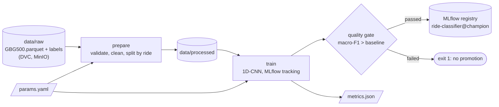
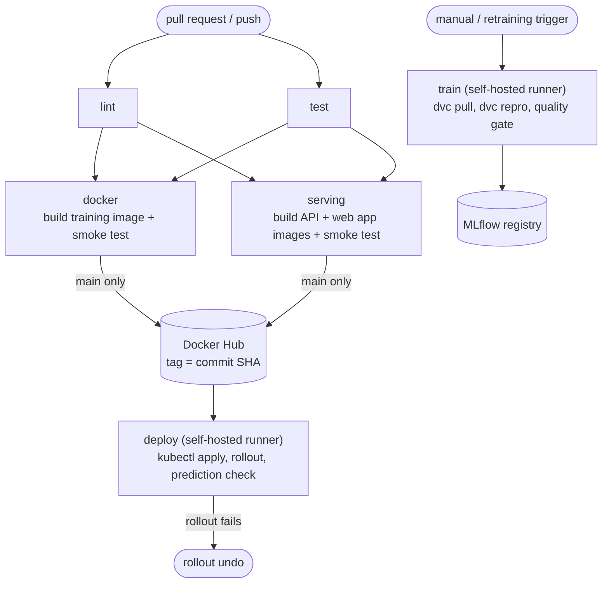
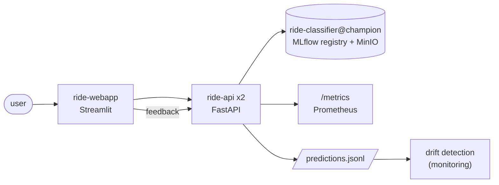

# Workflows (DAG) and API sizing

## 1. Workflow DAGs

### Data and training pipeline (DVC, `dvc.yaml`)

`dvc repro` only re-runs a stage when its inputs (data, code, parameters) changed.

### CI/CD (GitHub Actions)

### Request path (serving)

## 2. API sizing

Measured with `make load` (Locust, rides of 3 000 samples ≈ 5 min of riding, 8-core Apple Silicon laptop, one
API process with the real model `ride-classifier@champion`, 40 s per level, 0 failed request in every run).

| Concurrent users | Requests | Throughput | p50 | p95 | p99 |
|---|---|---|---|---|---|
| 1 | 232 | 5.9 req/s | 46 ms | 52 ms | 60 ms |
| 10 | 1 497 | 38 req/s | 120 ms | 240 ms | 290 ms |
| 20 | 1 650 | 42 req/s | 340 ms | 480 ms | 550 ms |

**Reading.** One process saturates around **40 req/s**: from 10 to 20 users the throughput no longer grows while the
latency triples, which is the signature of a CPU-bound service (one Python process, one core, the JSON parsing of
3 000 samples and the CNN inference). A single request costs about 25 ms of CPU.

**Sizing for Kubernetes.** The manifest `k8s/api.yaml` asks for 250 m CPU and 512 Mi per pod, with a limit of 1 CPU and
1 Gi. With one core per pod, 2 replicas serve about **80 req/s**, far above the expected traffic of this application
(a ride is classified once, after it ends). The two replicas are kept for **availability** (rolling update without
downtime, one pod can die), not for throughput. Scaling further is a matter of `replicas` (or a
HorizontalPodAutoscaler on CPU), since the pods are stateless.

**Limits of this measurement.** It was made on a laptop, outside Kubernetes, with synthetic rides (random noise): the
latency inside a pod limited to 1 CPU will be higher. It was not repeated on the cluster.

## 3. Check of the real model through the API

The real model trained by the pipeline (test macro-F1 0.2675) was served by the API and queried with 10 rides of the
GBG500 data (2 per class, all samples including the NaN sent as `null`): **7 of 10 correct**, latency 10 to 90 ms.
The mistakes are a *Reckless* ride predicted *Safe overall*, a *Safe overall* predicted *Safe* and a *Tandem*
predicted *Safe overall*, consistent with the confusion matrix in the README. This is a smoke check on rides that
include training data, not an evaluation: the evaluation is the test macro-F1.
